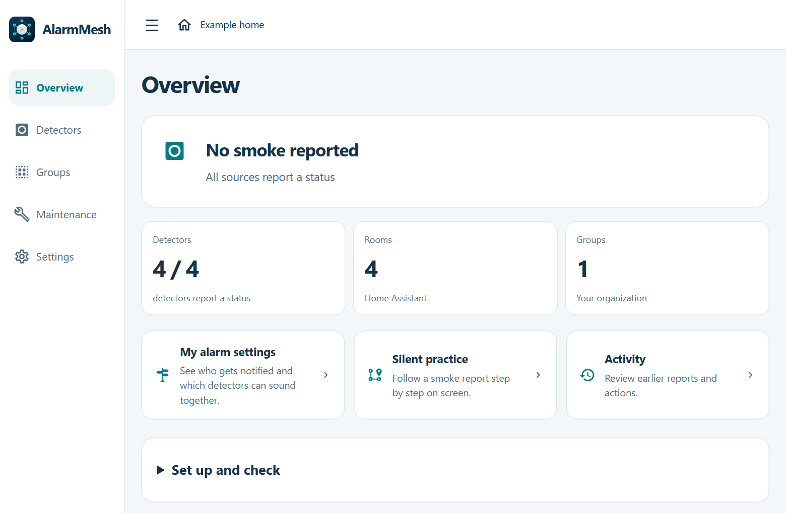
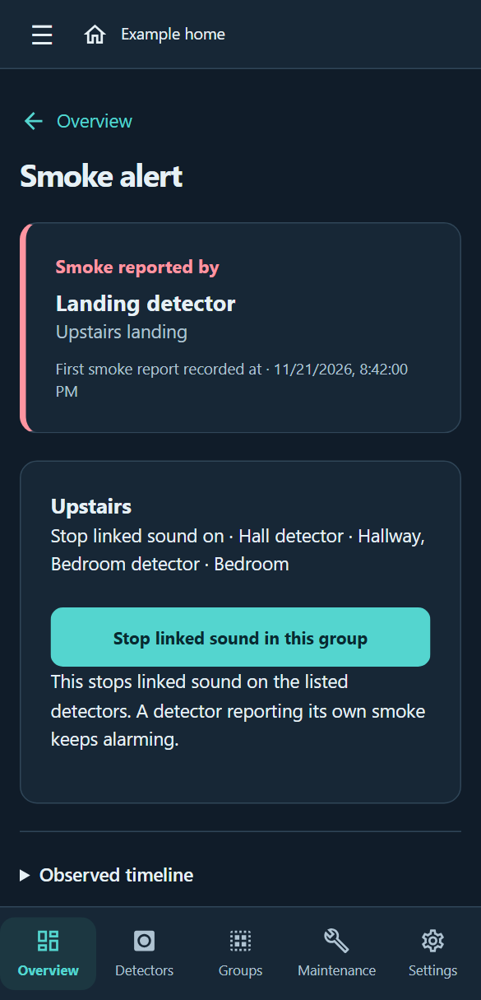
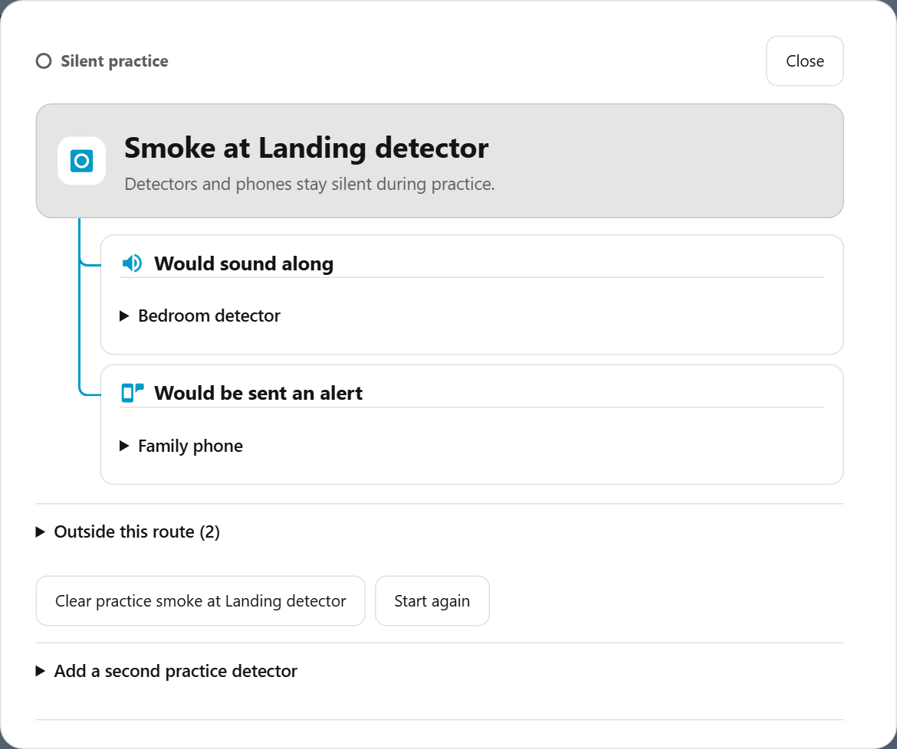

# AlarmMesh

<picture>
  <source media="(prefers-color-scheme: dark)" srcset="custom_components/alarmmesh/brand/dark_logo@2x.png">
  
</picture>

Available directly in the **Home Assistant Marketplace** and **HACS**.

AlarmMesh brings the smoke detectors you already have in Home Assistant into one view. If the landing detector reports smoke, you can see its name on your phone, tap the alert to open that incident, and see which other detectors have reported smoke. You decide whether any phones, linked sounders or Home Assistant scripts take part.

> [!IMPORTANT]
> **AlarmMesh is a supplementary tool, provided as is, without warranty.** It cannot replace certified smoke alarms or a certified fire alarm system. During a fire, a detector, Home Assistant or the network can fail, and an alert may arrive late or never arrive. Never rely on AlarmMesh alone for your safety. “No smoke reported” only describes the readings available to Home Assistant.

## Get started

You need Home Assistant **2026.10.4 or later**, administrator access, and at least one existing smoke detector entity (`binary_sensor` with device class `smoke`, or the Alecto SMART-SMOKE10 Zigbee2MQTT `Smoke state` sensor). Set up the detectors in their own integration first. You can use AlarmMesh immediately for monitoring, with all automatic actions off.

1. **Install AlarmMesh.** Use the button above, or search for **AlarmMesh** in **Settings → Marketplace** (Home Assistant 2026.11 or later) or **HACS** (2026.10.4 or a later 2026.10 patch). Choose **Install** in the Marketplace or **Download** in HACS. Restart Home Assistant if prompted. [Installation guide](docs/installation.md)
2. **Choose your detectors.** Open **Settings → Devices & services → Add integration → AlarmMesh** and select the smoke entities you want to follow. Give each a recognizable name and assign its area in Home Assistant. These names appear in the panel and in phone alerts.
3. **Check your setup.** Open **AlarmMesh** in the sidebar. **My alarm settings** shows the route for each detector. Open **Silent practice** to walk through an example with your family. You can do this before enabling any notifications or linked sound.

## When a detector reports smoke

- **On your phone**, an alert such as **Smoke alert · Landing detector** identifies the source. The first line includes its Home Assistant area when assigned. If a second detector reports smoke, the next alert leads with that detector. In AlarmMesh, choose which Companion App phones receive alerts and whether each phone uses a critical alert. Delivery and sound depend on the phone's permissions and settings.
- **On the incident screen**, you see which detectors are reporting smoke now and when the first report arrived. The affected group's **Stop linked sound in this group** button lists the detectors it can control. A detector reporting its own smoke keeps alarming. Opening the notification only displays the incident.
- **Afterwards**, the activity timeline shows smoke reports and clearances, which starts and stops AlarmMesh requested, and any available siren feedback. A command accepted by Home Assistant does not establish what anyone heard. An older notification opens the incident it came from.

## What you can set up

| Feature | How you might use it |
| --- | --- |
| Detectors and rooms | Find a detector by name or room. Check its smoke state, battery percentage and device information where the provider exposes them. An unreachable source is marked separately. |
| Groups and linked sound | Group detectors by floor or zone. If a detector supports remote activation, explicitly select it to sound when another group member reports smoke. Creating a group leaves linked sound off by default. |
| Phone alerts and actions | Choose Companion App recipients, configure critical alerts, and record whether a test notification was received and heard. Optionally run selected Home Assistant scripts when smoke starts or clears. |
| Silent practice | Pick a detector and follow the branches to other sounders, phones and scripts. See why a particular action would stay off. The exercise runs on screen and sends no commands. |
| Maintenance | Review battery and connectivity reports, schedule reminders and record a battery change or maintenance visit. A manual journal entry stays separate from device readings and self-test results. |
| Dashboards | Use the smoke and source-availability entities in your own dashboards. The optional family card opens the relevant incident or detector. The management panel and family card require an administrator account. |

### Two views from the simulator

<strong>Phone screen during an incident</strong> — see the source and the group stop button

The landing detector is reporting smoke. The group button lists the hall and bedroom detectors because they are sounding along.

<strong>Silent practice</strong> — follow the same route before you enable it

In this example, a report from the landing would sound the bedroom detector and notify the family phone. You can expand each branch to see why it participates.

## Will my detector work?

**Reading smoke, starting linked sound and stopping linked sound are separate capabilities.** AlarmMesh can follow an existing Home Assistant smoke entity even when its model has no remote sounder control. Groups can mix sources from Zigbee2MQTT, ZHA, Matter and Z-Wave JS. Available controls depend on the receiving model, its provider and the entities exposed in your installation.

| Example | What to expect |
| --- | --- |
| Alecto SMART-SMOKE10 via Zigbee2MQTT | Choose **Smoke state** directly. `alarm` reports smoke and `normal` clears it. Missing or unavailable readings remain indeterminate. Detection only. |
| Heiman HS1SA-E-PLUS via Zigbee2MQTT | With a verified control and linking enabled, it can sound along. The group button can stop a linked tone that AlarmMesh started and identified. The detector's own smoke status is checked again before a stop. |
| Aqara JY-GZ-01AQ via Zigbee2MQTT | Can start linked sound when its prerequisites are met. AlarmMesh never sends the Aqara mute command because it can also silence the detector's own local alarm. |
| Matter smoke detector | AlarmMesh can display smoke reports and the diagnostics exposed by Home Assistant. The Matter integration in AlarmMesh offers no remote sounder or mute command. |

Look up your model **and its provider** in the compatibility catalog. The catalog covers **53 converter definitions and 68 model or variant entries**, including devices with limited capabilities. [Device catalog](docs/device-catalog.md) · [Linked sound and prerequisites](docs/linked-sounding.md) · [Matter](docs/matter-support.md) · [Z-Wave JS](docs/zwave-support.md)

## Guides and support

- [Panel guide and dashboard card setup](docs/panel.md)
- [Installation, updates and removal](docs/installation.md)
- [Troubleshooting](docs/troubleshooting.md) · [Report an issue](https://github.com/Xat0X/AlarmMesh/issues)
- [Releases and installation packages](https://github.com/Xat0X/AlarmMesh/releases) · [Changelog](CHANGELOG.md) · [Development and simulator setup](docs/development.md)

Created with ❤️ by [Xat0X](https://github.com/Xat0X). [MIT License](LICENSE)
